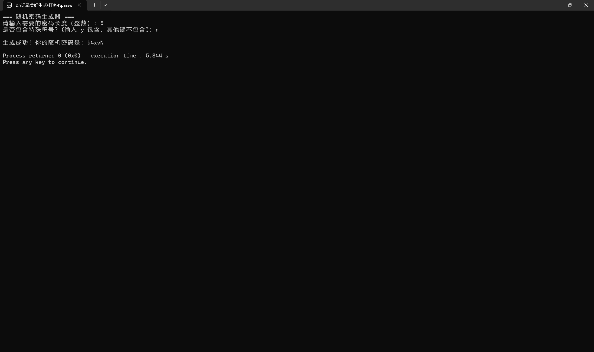
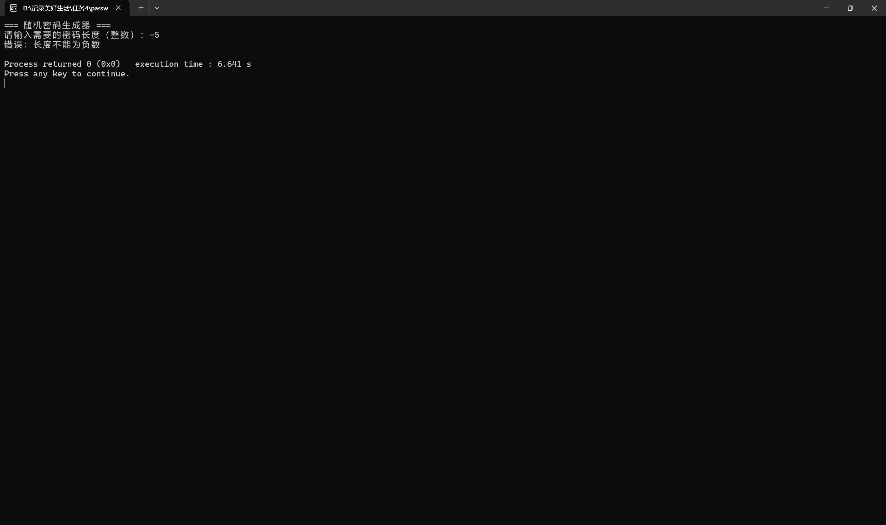
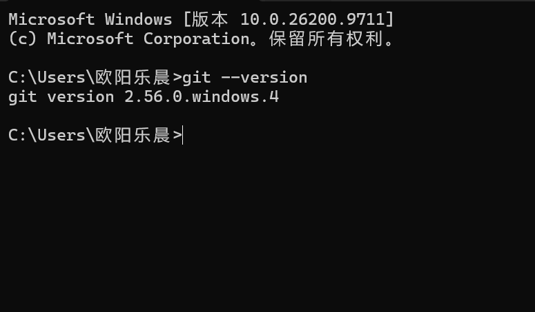
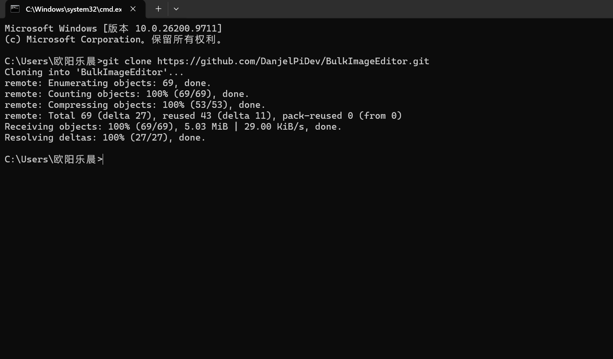
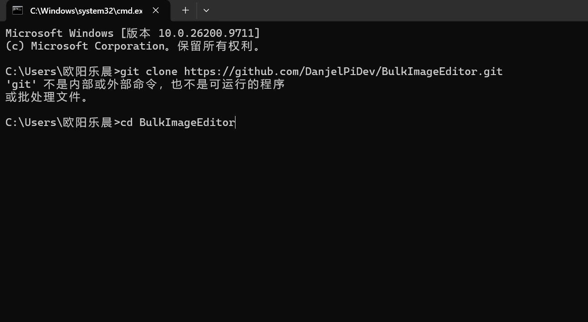
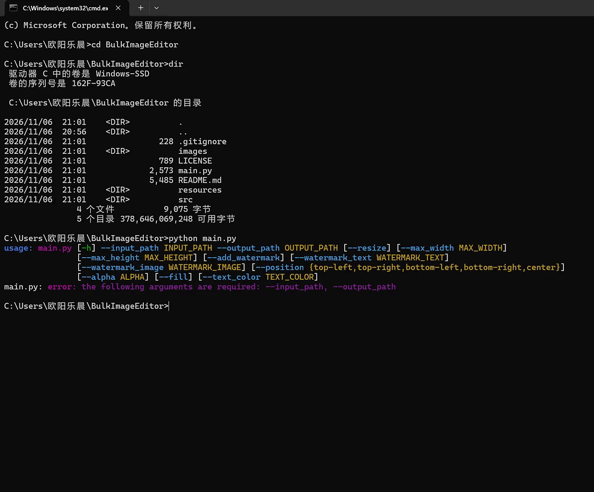
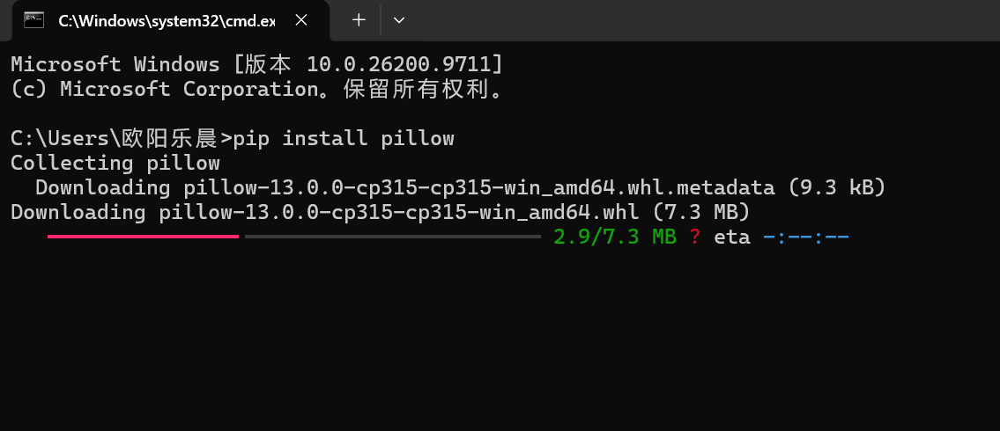
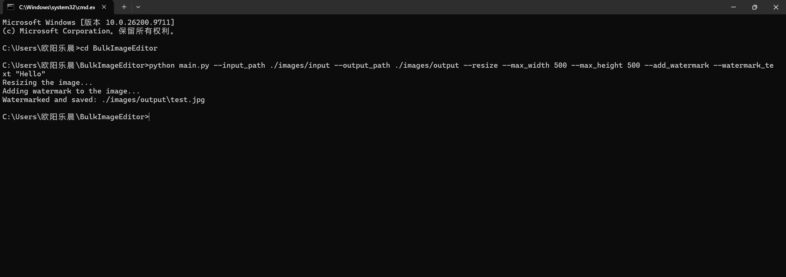
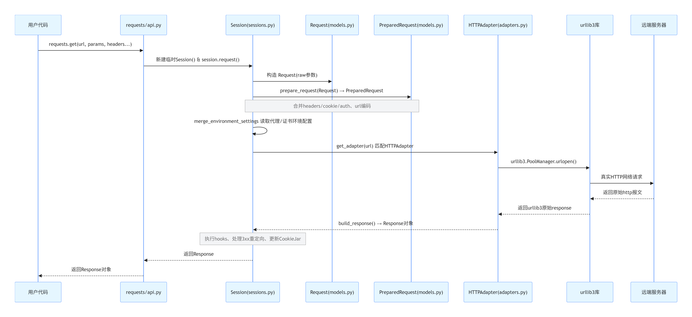

11.2 周一
完成任务 2：提示词工程实战——场景生成与出图，豆包生成“硬核科幻赛博朋克微型场景”，通过修改关键词不断优化生成效果。


11.3 周二
做OJ、洛谷题目，提升C语言基础，配置Python环境准备后续学习任务，了解Agent知识，学写AI关键词，学习如何使用AI制作项目。


11.4 周三
完成任务 4：Agent 从零生成可运行小工具。
任务 4
命令行随机密码生成器

完整提示词：
目标功能：用 C 语言写一个命令行随机密码生成器。需要支持指定密码长度，并可指定是否包含特殊符号。

运行环境：C语言（C99标准），可在 Windows 终端下使用 GCC 编译运行。

输入输出格式：
1. 程序运行后，首先提示用户输入需要的密码长度（整数）。
2. 接着提示用户选择是否包含特殊符号（输入 'y' 包含，输入 'n' 或其他键不包含）。
3. 根据用户的输入，在终端打印生成好的随机密码。
边界情况处理逻辑：
1. 如果用户输入的长度是 0，程序应输出“错误：长度必须大于0”并安全退出，不能崩溃。
2. 如果用户输入的是负数（如 -5），程序应输出“错误：长度不能为负数”并安全退出。
3. 如果输入的不是整数（如字母 'abc'），程序应提示“错误：请输入有效的整数”并退出。
4. 如果用户选择不包含特殊符号（输入 'n'），生成的密码中只能包含大小写字母和数字，绝对不允许出现符号。
5. 注意处理 C 语言中 scanf 输入后的回车符残留问题，确保用户能顺利完成两次输入。
代码注释要求：关键逻辑（如随机数种子初始化、内存分配、字符集拼接、边界检查）必须加上清晰的中文注释。包含必要的头文件。

最终代码截图：
```c
#include <stdio.h>
#include <stdlib.h>
#include <time.h>

int main() {
    int length, i;
    char include_symbols;

    // 初始化随机数种子
    srand((unsigned int)time(NULL));

    printf("=== 随机密码生成器 ===\n");
    printf("请输入需要的密码长度（整数）：");

    // 读取输入并检查是否为有效整数
    if (scanf("%d", &length) != 1) {
        printf("错误：请输入有效的整数。\n");
        return 1;
    }

    // 边界情况 1：长度为 0
    if (length == 0) {
        printf("错误：长度必须大于0\n");
        return 0;
    }

    // 边界情况 2：输入负数
    if (length < 0) {
        printf("错误：长度不能为负数\n");
        return 0;
    }

    // 安全限制：防止输入过大导致内存问题
    if (length > 100) {
        printf("错误：密码长度过长，请输入 100 以内的数字。\n");
        return 0;
    }

    // 清理输入缓冲区中残留的回车符，防止下面的 getchar 误读
    while (getchar() != '\n');

    // 处理是否包含符号
    printf("是否包含特殊符号？(输入 y 包含，其他键不包含)：");
    scanf("%c", &include_symbols);

    // 动态分配内存
    char *password = (char *)malloc((length + 1) * sizeof(char));
    if (password == NULL) {
        printf("内存分配失败！\n");
        return 1;
    }

    // 定义基础字符集：大小写字母和数字
    char basic_charset[] = "abcdefghijklmnopqrstuvwxyzABCDEFGHIJKLMNOPQRSTUVWXYZ0123456789";
    char symbol_charset[] = "!@#$%^&*()-_=+[]{}|;:,.<>?";

    // 生成随机密码
    for (i = 0; i < length; i++) {
        if (include_symbols == 'y' || include_symbols == 'Y') {
            // 如果包含符号，总共有 10 种标点符号（这里简单算一下，实际看上面字符串长度）
            // 为了简单，我们采用 50% 概率出符号，50% 概率出基础字符
            int rand_num = rand() % 100;
            if (rand_num < 50) {
                // 从基础字符集取
                password[i] = basic_charset[rand() % (sizeof(basic_charset) - 1)];
            } else {
                // 从符号字符集取
                password[i] = symbol_charset[rand() % (sizeof(symbol_charset) - 1)];
            }
        } else {
            // 不包含符号，纯字母数字
            password[i] = basic_charset[rand() % (sizeof(basic_charset) - 1)];
        }
    }
    password[length] = '\0'; // 字符串结尾符

    printf("\n生成成功！你的随机密码是：%s\n", password);

    // 释放内存
    free(password);

    return 0;
}
```

运行截图：


边界测试：



第一次运行时所出现问题：缺少“可指定是否包含符号”这个交互功能、在输入长度后按了回车，未清理缓冲区，导致后续字符无法输入
修改后：加了符号交互：增加了 include_symbols 变量，提示用户输入 y 或其他键、修复了 getchar 吞字符的 Bug：在 scanf("%d") 之后加了一行 while (getchar() != '\n')。


11.5 周四
登录GitHub账号，了解GitHub功能，继续学习C语言内容，自觉缺少经验，决定从题目中掌握更多方法。


11.6 周五
完成任务 1、3：GitHub 同名主页仓库搭建，夯实 Git 基础认知、需求驱动，借助 Agent 检索、拉取、试跑轻量开源项目。

任务 1
提问：1.同名用户名仓库为什么是特殊仓库？它和存放 C 项目的普通代码仓库有什么区别？
答：GitHub同名用户仓库具有展示个人资料页面的功能；同名仓库用于个人展示与介绍，普通仓库用于存放和管理项目源代码，同名仓库依赖仓库名称与用户名严格匹配（且为公开仓库）来触发主页展示功能。同名仓库主要包含 README.md（可含图片、链接等 Markdown 内容）；普通仓库则包含源代码（.c 文件）、头文件（.h）、构建脚本（如 Makefile）等实际项目文件。创建同名仓库时，GitHub 会提示“这是一个特殊仓库”，确认其已识别该功能；创建普通仓库时，系统仅视其为常规项目。

提问：2.README.md 是什么？Markdown 语法在 GitHub 仓库里的作用是什么？
答：README.md 是一个采用 Markdown 格式编写的文本文件，通常放在代码仓库的根目录下，它相当于项目的“说明书”或“首页”；Markdown语法在GitHub仓库中主要具有渲染富文本内容、编写项目文档、展示代码与表格、支持任务列表与引用、跨平台通用的作用。

提问：3.什么是 commit 提交记录？一份规范的 commit message 一般怎么写，为什么需要规范提交信息？
答：Commit（提交记录）是 Git 版本控制系统中的核心概念。简单来说，它是对项目在某一特定时刻所有文件状态的一次快照。

commit message基本结构：
<类型>[可选作用域]: <简短描述>

[可选正文]

[可选脚注]

类型是必填的，用来表明这次提交的性质。最核心的两种是：
• feat：新增功能。
• fix：修复缺陷。
此外，社区实践中还常使用 docs（文档）、style（格式调整）、refactor（重构）、test（测试）、chore（杂务）等类型。

规范提交信息的价值体现在让历史可读、可追溯、支持自动化工具。

任务 3
选题：图片批量处理脚本。
仓库链接：https://github.com/DanjelPiDev/BulkImageEditor。

clone截图：


报错截图：



环境配置：
；

原图：

运行过程：

运行结果（产出）：

（为什么没有水印：这种开源的简易脚本，通常默认 images/watermark 文件夹里有一张水印图片（比如一张透明底的 logo 图）。如果你只给了文字，它内部的代码逻辑可能没处理好，或者它没找到默认的字体文件（Windows 下经常因为找不到系统字体而默默跳过水印）。）


11.7 周六
总结任务，整理笔记，尝试完成任务5：Agent逆向分析指定开源项目。
任务 5
https://github.com/psf/requests（ Python HTTP库）；

函数模块调用流程图：

其中sessions.py文件作用：
1. 存 cookie、默认请求头、适配器，多次请求可以共用登录状态、连接；
2. 收到请求后，先把参数整理成标准待发请求；
3. 找到合适的适配器，让适配器去发网络请求；
4. 拿到返回结果后，自动存新 cookie、跑回调、处理跳转；
5. 还支持你自己挂载自定义适配器，最后能统一关闭连接。


总结：经过本周学习，学会了将AI作为直接参与代码编写与项目制作的工具，而不再仅仅用于聊天，也认识到了仅学习C语言这一基础语法存在局限性，发现GitHub上许多开源项目采用其他语法，需求其他环境配置，在接下来的学习中，将重点夯实C语言基础，并了解其他语法，同时利用AI工具学习GitHub上的简单开源项目。