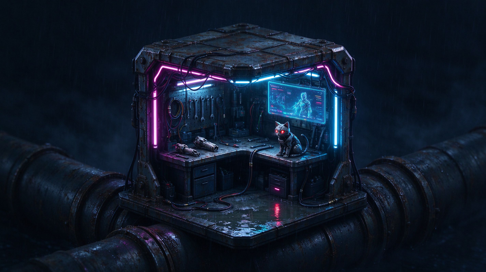

Agent图片生成（豆包）
1. 第一轮原始提示词：
帮我生成一个等轴测视角的赛博朋克风格微型场景描述，配套一份绘图提示词。场景主体是一个狭小的赛博格改装维修站，悬浮在废旧管道之上。包含闪烁的霓虹灯管、生锈的金属外壳、全息投影广告牌、机械义肢零件，以及脚边蹲着一只机械猫。背景是阴暗潮湿的雨夜，地面积水反光，未来科技感，高对比度，细节丰富。输出分成两部分：第一部分是场景文字描述，第二部分是可以直接给绘图模型使用的提示词（中英文皆可）。

Agent返回：（修改前提示词）
文字描述：
等轴测视角下，一间局促逼仄的赛博格改装维修站悬空架在纵横交错、斑驳老化的巨型废旧管道之间。维修站外壳是锈蚀斑驳的哑光金属板，焊痕与刮痕密布，边角微微变形；数根霓虹灯管沿着棚架轮廓蜿蜒缠绕，粉紫与冰蓝的光线不停频闪，在潮湿空气里晕开朦胧的光雾。站内杂乱堆放着拆解过半的机械义肢、裸露的线缆、液压管线与微型维修工具，半透明全息广告牌悬浮在维修站外侧，浮动着扭曲模糊的流光文字。维修站边缘的积水平台上，一只机械猫蜷蹲在脚边，合金外壳带着磨损划痕，光学猫眼微微亮起淡红光点。
整座场景浸在阴暗的雨夜之中，细密雨丝持续坠落，管道与平台上积着浅浅水洼，霓虹、全息光在水面形成破碎晃动的反光。远处是层层叠叠隐在雨幕里的昏暗城市轮廓，雾气厚重，明暗高对比，冷湿颓废的氛围包裹着充满粗粝未来感的微型维修据点，细节细碎丰富，空间紧凑。
绘图提示词：
等轴测视角，赛博朋克微型场景，狭小的赛博格改装维修站悬浮在粗大废旧管道上方，生锈金属外壳，明显焊痕磨损痕迹，闪烁粉紫色与冰蓝色霓虹灯管，空气中雨雾，悬浮全息投影广告牌，散落的机械义肢零件、管线、维修工具，维修台边缘蹲着一只机械猫，金属机械躯体，红色光学猫眼，阴暗雨夜，细密雨丝，地面浅积水，水面反射霓虹与全息光影，潮湿雾气，高对比度，电影光影，细节丰富，废土未来质感，暗调，精致材质，金属锈蚀质感，柔和反光，干净等轴测构图，无多余元素。

修改思路：解决第一轮“动态词难静态化 + 远景与干净构图冲突 + 细节密度失控”三个问题，把提示词收敛为静态可画、主体明确、背景干净的版本。

2. 第二轮提示词：
等轴测视角，赛博朋克微型场景，狭小的赛博格改装维修站悬浮在粗大废旧管道上方，生锈金属外壳，焊痕与磨损痕迹清晰，粉紫色与冰蓝色霓虹灯管沿棚架轮廓缠绕，霓虹光在潮湿空气中形成柔和光晕，悬浮全息投影广告牌，散落的机械义肢零件、裸露线缆、液压管线与维修工具集中在站内，维修台边缘蹲着一只小型机械猫，金属躯体带磨损划痕，红色光学猫眼微亮，阴暗雨夜，地面浅积水，水面破碎反射霓虹与全息光影，高对比度，电影光影，金属锈蚀质感，暗调精致材质，等轴测构图主体居中，背景为纯暗色雨雾、不含远处建筑轮廓，画面干净无多余杂物，机械猫约占画面高度五分之一。

Agent返回：
文字描述：
等轴测视角，画面中心悬浮着一间紧凑狭小的赛博格改装维修站，架设在粗壮陈旧的废旧管道之上。维修站外壳布满锈蚀痕迹，焊痕、磕碰磨损清晰可见；粉紫与冰蓝色霓虹灯管顺着棚架轮廓环绕缠绕，光线在潮湿雨夜的空气里弥散出柔和朦胧的光晕。站内集中摆放着拆解开来的机械义肢零件、裸露的线路、液压管线与各式维修工具，一块全息投影广告牌漂浮在站点外侧。维修台边缘蹲坐着一只小型机械猫，金属外壳带着使用划痕，一对红色光学猫眼微微发光。周遭是阴暗雨夜，平台上积着浅水洼，霓虹与全息的光线在水面碎裂晃动、形成倒影。背景只有纯粹暗沉的雨雾，没有远处建筑，画面干净简洁，主体居中，高对比电影感光影，暗调配精致材质，机械猫尺寸可控，大约占画面高度的五分之一。
绘图提示词：
等轴测视角，赛博朋克微型场景，狭小的赛博格改装维修站悬浮在粗大废旧管道上方，生锈金属外壳，焊痕与磨损痕迹清晰，粉紫色与冰蓝色霓虹灯管沿棚架轮廓缠绕，霓虹光在潮湿空气中形成柔和光晕，悬浮全息投影广告牌，散落的机械义肢零件、裸露线缆、液压管线与维修工具集中在站内，维修台边缘蹲着一只小型机械猫，金属躯体带磨损划痕，红色光学猫眼微亮，阴暗雨夜，地面浅积水，水面破碎反射霓虹与全息光影，高对比度，电影光影，金属锈蚀质感，暗调精致材质，等轴测构图主体居中，背景为纯暗色雨雾，不含远处建筑轮廓，画面干净无多余杂物，机械猫约占画面高度五分之一

修改思路：解决三个问题——删掉“尺寸可控”这类指令性语言；统一“线缆/线路”用词；给画面一个明确的视觉焦点（用机械猫的红眼和全息牌的光作为引导），让主体不再只是“居中”而是“有重心”。

3. 第三轮提示词：
等轴测视角，赛博朋克微型场景，狭小的赛博格改装维修站悬浮在粗大废旧管道上方，生锈金属外壳，焊痕与磨损痕迹清晰，粉紫色与冰蓝色霓虹灯管沿棚架轮廓缠绕，霓虹光在潮湿空气中形成柔和光晕，一块悬浮全息投影广告牌位于维修站外侧偏上位置，作为画面次焦点散发流动的冷色光，散落的机械义肢零件、裸露线缆、液压管线与维修工具集中在站内，维修台边缘蹲着一只小型机械猫，金属躯体带磨损划痕，红色光学猫眼是画面最亮点、微微发光并在地面浅水洼中投下一点红色反光，阴暗雨夜，地面浅积水，水面破碎反射霓虹与全息光影，高对比度，电影光影，金属锈蚀质感，暗调精致材质，等轴测构图主体居中，背景为纯暗色雨雾、不含远处建筑轮廓，画面干净无多余杂物，机械猫约占画面高度五分之一。

Agent返回：
文字描述：
等轴测视角下，画面正中央是一间紧凑狭小的赛博格改装维修站，悬空搭建在粗壮老旧的废旧管道之上。维修站外壳锈蚀明显，焊痕与磕碰磨损痕迹清晰；粉紫色与冰蓝色霓虹灯管沿着棚架轮廓缠绕，光线在潮湿的雨夜空气里晕开柔和光晕。一块悬浮全息投影广告牌安置在维修站外侧偏上方，作为画面次焦点，流淌着冷色流光。站内集中堆放着拆解的机械义肢零件、裸露线缆、液压管线和各类维修工具。维修台边缘蹲伏着一只小型机械猫，金属躯体布满磨损划痕，它的红色光学猫眼是整幅画面最亮眼的光源，微光在脚下的浅水洼里映出一点细碎的红色倒影。
环境是阴沉的雨夜，平台积着浅浅水洼，霓虹与全息的光影在水面破碎晃动、形成扭曲反光。背景只有纯粹暗沉的雨雾，没有任何远处建筑轮廓，画面干净利落，没有多余杂物，采用标准等轴测居中构图，机械猫尺寸约占画面高度的五分之一，整体光影高对比，暗调配精致写实材质，充满赛博朋克的冷寂质感。
绘图提示词：
等轴测视角，赛博朋克微型场景，狭小的赛博格改装维修站悬浮在粗大废旧管道上方，生锈金属外壳，焊痕与磨损痕迹清晰，粉紫色与冰蓝色霓虹灯管沿棚架轮廓缠绕，霓虹光在潮湿空气中形成柔和光晕，一块悬浮全息投影广告牌位于维修站外侧偏上位置，画面次焦点，散发流动冷色光，散落的机械义肢零件、裸露线缆、液压管线与维修工具集中在站内，维修台边缘蹲着一只小型机械猫，金属躯体带磨损划痕，红色光学猫眼是画面最亮点，微微发光并在地面浅水洼中投下一点红色反光，阴暗雨夜，地面浅积水，水面破碎反射霓虹与全息光影，高对比度，电影光影，金属锈蚀质感，暗调精致材质，等轴测构图主体居中，背景为纯暗色雨雾，不含远处建筑轮廓，画面干净无多余杂物，机械猫约占画面高度五分之一

修改思路：给材质和细节分配层次——主体（维修站外壳、机械猫）精细，辅助元素（管线、工具、远景管道）适度简化，让“精致”落在该落的地方，而不是均匀铺满。

4. 第四轮提示词：
等轴测视角，赛博朋克微型场景，狭小的赛博格改装维修站悬浮在粗大废旧管道上方，维修站外壳为锈蚀哑光金属，焊痕、刮擦与边角变形清晰可辨，材质细节集中在外壳与维修台台面，粉紫色与冰蓝色霓虹灯管沿棚架轮廓缠绕，霓虹光在潮湿空气中晕开柔和光晕，一块悬浮全息投影广告牌位于维修站外侧偏上，散发流动冷色光，站内散落机械义肢零件、裸露线缆、液压管线与维修工具，这些辅助物件轮廓概括、不做过度刻画，维修台边缘蹲着一只小型机械猫，金属躯体带磨损划痕，红色光学猫眼在暗调画面中最为明亮，并在脚下浅水洼中映出一点红色反光，阴暗雨夜，平台浅积水，水面破碎反射霓虹与全息光影，高对比度，电影光影，金属锈蚀质感层次分明，暗调精致材质，等轴测构图主体居中，背景为纯暗色雨雾、不含远处建筑轮廓，画面干净无多余杂物，机械猫约占画面高度五分之一。

最终结果：
